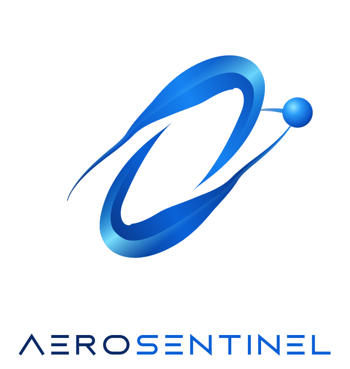
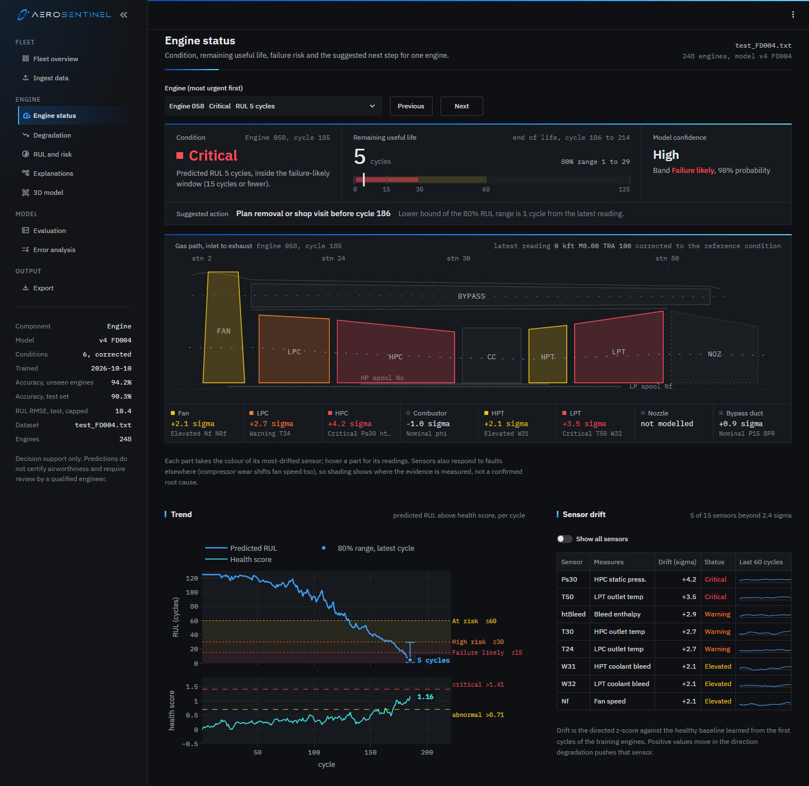
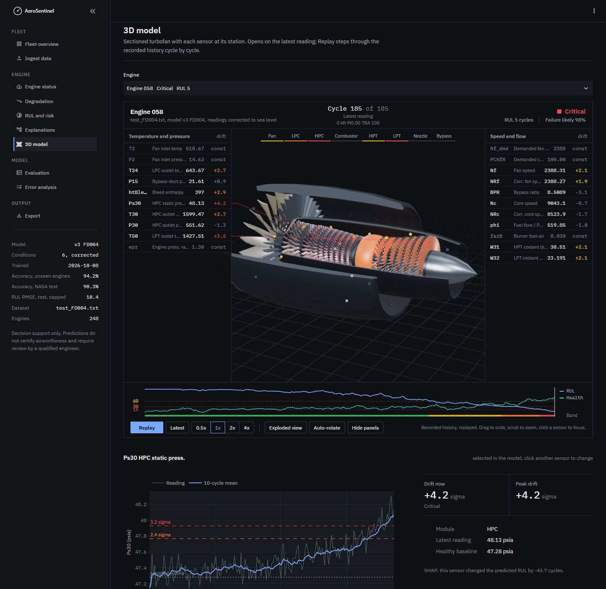
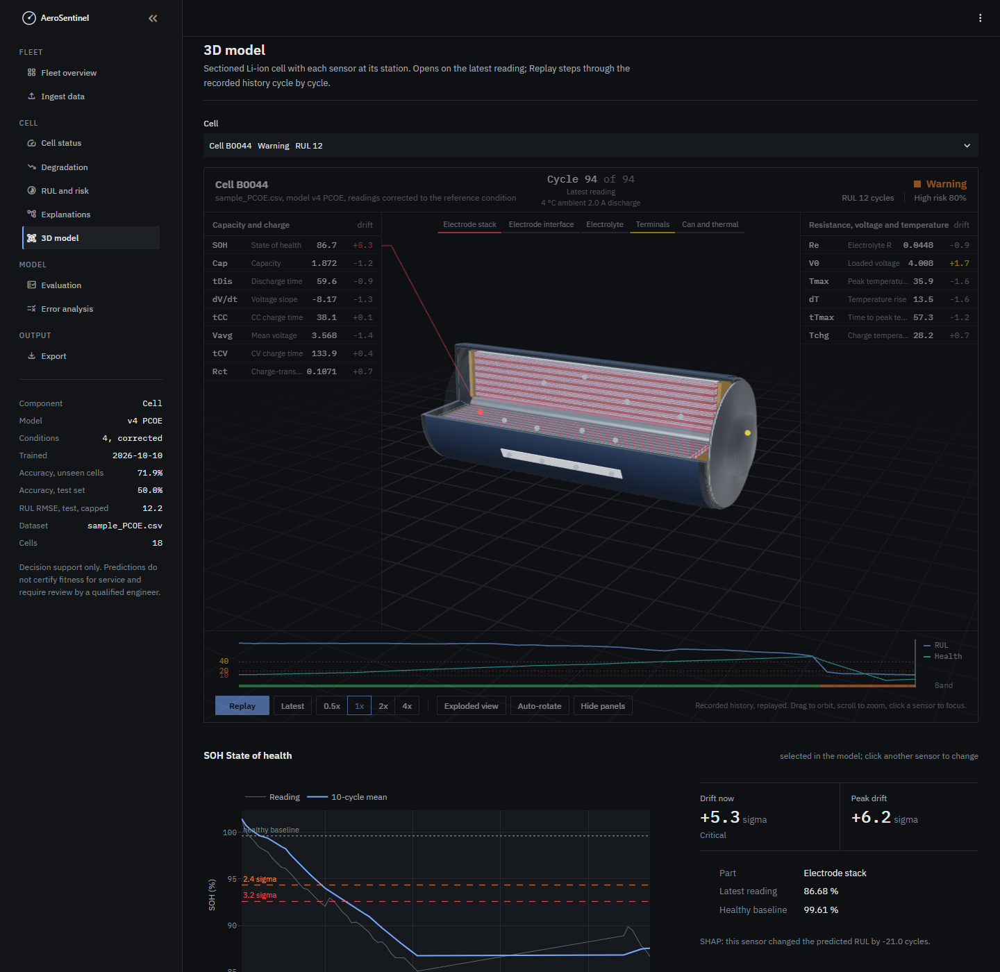
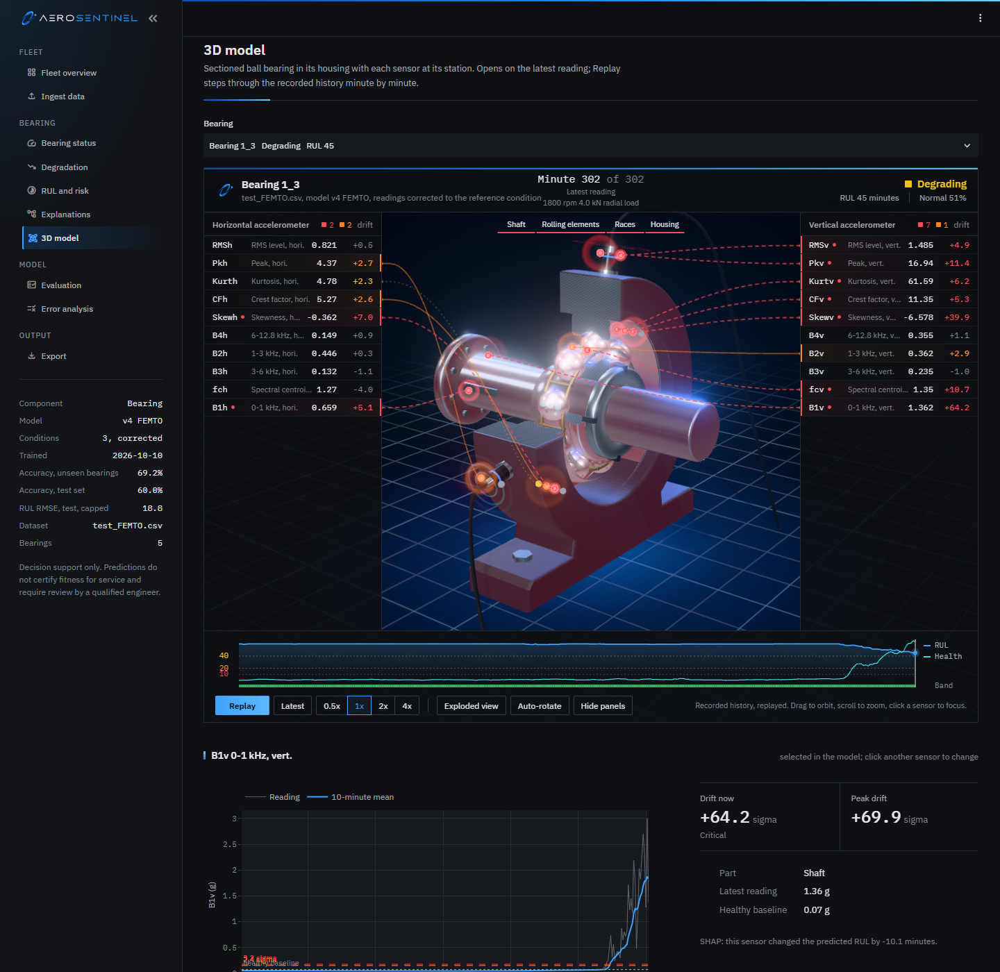
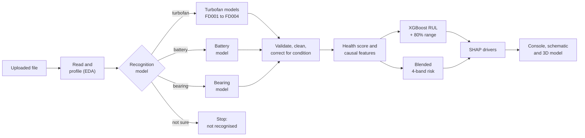

<p align="center">
  
</p>

<p align="center">
  
  
  
  
</p>

<p align="center">
  <picture>
    <source media="(prefers-color-scheme: dark)" srcset="assets/logo_full_dark.svg" />
    
  </picture>
</p>

<p align="center">
  <b>Which engine, battery cell or bearing needs attention next, how long it has left, and which sensors are saying so.</b>
</p>

<p align="center">
  Predictive maintenance for aircraft components. A recognition model reads an uploaded file and decides whether it
  comes from a turbofan engine, a Li-ion battery cell or a rolling bearing; that component's own models then forecast
  remaining useful life, place it in one of four risk bands and explain why, in an engineering console with a schematic
  and a 3D model of every component.
</p>

<p align="center">
  <a href="#quick-start">Quick start</a> ·
  <a href="#inside-the-console">Inside the console</a> ·
  <a href="#how-it-works">How it works</a> ·
  <a href="#results">Results</a> ·
  <a href="#limitations-and-responsible-use">Limitations</a>
</p>

<table align="center">
  <tr>
    <td align="center"><h2>3</h2>component models<br/><sub>turbofan · battery · bearing</sub></td>
    <td align="center"><h2>100%</h2>files sent to the right model<br/><sub>600 unseen test files · 0 misrouted</sub></td>
    <td align="center"><h2>90 to 93%</h2>turbofan risk bands correct<br/><sub>NASA test sets · 707 engines</sub></td>
    <td align="center"><h2>9.6 to 10.7</h2>turbofan RUL error, cycles<br/><sub>RMSE · true RUL capped at 125</sub></td>
    <td align="center"><h2>6</h2>flight conditions corrected<br/><sub>altitude · Mach · throttle</sub></td>
  </tr>
</table>

---

## Why it exists

Engines, batteries and bearings rarely fail without warning. A turbofan's compressor wears and its temperatures creep
up; a Li-ion cell loses capacity and takes longer to charge; a bearing's races pit and its vibration grows sharper. The
signs are spread across many sensors, buried under the effect of how the part is being used (altitude, temperature,
load), and they look completely different from one component to the next. Fixed maintenance schedules ignore all of it.

AeroSentinel takes a file of sensor readings, works out which component it describes, removes the effect of the
operating condition, and answers four questions for every unit:

| Question | What you get |
|---|---|
| **How long has it got?** | Remaining useful life (RUL) in the component's own units (engine cycles, discharge cycles or minutes), an 80% range and the end-of-life window |
| **How worried should I be?** | One of four risk bands, *Normal*, *At risk*, *High risk* or *Failure likely*, with the model's probability |
| **What is changing, and where?** | A health score against healthy units, and the drift of every sensor, part by part on the component's schematic |
| **Why does the model think so?** | The sensors that pushed this prediction up or down, ranked by SHAP |

---

## Inside the console



**Unit status** puts everything about one engine, cell or bearing on a single screen: its condition, RUL on a banded
scale, the end-of-life window and how confident the model is. Below it, an engineering **schematic** of the component
is shaded part by part by sensor drift: the turbofan gas path with stations 2, 24, 30 and 50, the cell cross-section
from negative to positive terminal, or the bearing with its races, balls, shaft and housing. The operating condition of
the latest reading sits in the corner. *Previous* and *Next* step through the fleet, and the readouts animate from one
unit to the next.



**3D model** places every sensor channel at its station on a sectioned model of the component, lit like a product
render (physically based materials, a studio environment, soft shadows, a brand-blue rim light and a restrained bloom
on hot parts and alarms):

- a two-spool turbofan with a painted spinner swirl, polished inlet lip, chevron exhausts, bolted case flanges, running
  rotors, airflow and a combustor that glows with exhaust-temperature drift;
- an 18650 Li-ion cell cut open to show every electrode layer to scale (aluminium and copper foils, cathode, anode,
  separators), a printed sleeve, a vented cap, and lithium ions crossing the separators while it discharges;
- a ball bearing in a cast pillow block with a riveted cage, a bolted coupling, a lock nut, a grease nipple and two
  cabled accelerometers that radiate rings at a rate and colour set by the measured vibration.

The component assembles part by part when it opens. **Every sensor beyond the elevated drift limit is tied to its
station by a leader line**: dashed and flowing for critical, solid for warning, dotted for elevated. Warning and critical
stations pulse, the panel headers count them, and the floor ripples while the unit is in a warning or critical state.
*Replay* plays back the unit's recorded life while the top bar tracks the operating condition, and an event log notes
each escalation. Keys: `Space` replay or pause, `E` exploded view, `H` hide panels, `Esc` reset the camera.

<table>
  <tr>
    <td width="50%"></td>
    <td width="50%"></td>
  </tr>
  <tr>
    <td><sub>Battery cell: every electrode layer in the cut, the printed sleeve and thermocouple, and the state of health over its life.</sub></td>
    <td><sub>Bearing near failure: a leader line from every drifting vibration channel to its accelerometer, race, ball set or shaft.</sub></td>
  </tr>
</table>

**Ingest data** shows the whole decision chain for a new file: a data profile (shape, missing values, duplicates,
outliers, per-column distributions and the most related columns), the recognition model's verdict with its confidence
and the data signals behind it, then a timed processing report and the **operating envelope**: where the data was
recorded, against the conditions the model was trained on.

### Five condition states

Every unit is in exactly one state, always shown as a word and never by colour alone. Band limits are set per component.

| State | Meaning | Turbofan | Battery cell | Bearing |
|---|---|---|---|---|
| **Critical** | Predicted band is *Failure likely* | 15 cycles or fewer | 10 cycles or fewer | 10 minutes or fewer |
| **Warning** | Predicted band is *High risk* | 16 to 30 cycles | 11 to 20 cycles | 11 to 20 minutes |
| **Degrading** | *At risk*, or the health score is already abnormal | 31 to 60 cycles | 21 to 40 cycles | 21 to 40 minutes |
| **Healthy** | *Normal* band and normal health | | | |
| **Insufficient data** | Too short a history for reliable trends; never hides a Critical or Warning result | under 30 cycles | under 10 cycles | under 20 minutes |

<details>
<summary><b>Every page in the console</b></summary>
<br/>

| Section | Page | What it is for |
|---|---|---|
| Fleet | **Fleet overview** | A spec strip (component, model, conditions, degradation mode), units ranked by urgency, RUL forecast with 80% ranges, attention queue, health-trend heatmap and fleet-wide drivers. Click any unit to open it. |
| Fleet | **Ingest data** | Upload a file or pick a sample fleet; data profile, component recognition, automatic or manual model choice, timed processing report and operating envelope. |
| Engine, Cell or Bearing | **Unit status** | The single-unit summary and component schematic shown above. The section is named after the loaded component. |
| | **Degradation** | Health score over time, the full sensor-drift table, and any sensor plotted against its healthy baseline. |
| | **RUL and risk** | RUL history across the risk bands, the 80% range, review flags and a filterable fleet table. |
| | **Explanations** | SHAP drivers behind the RUL and the risk prediction. |
| | **3D model** | The sectioned component shown above, with a deep-dive chart for any sensor you click. |
| Model | **Evaluation** | Every component model side by side, the recognition model's results, the turbofan generalisation matrix, then baselines, per-band results and confusion matrices for one model. |
| Model | **Error analysis** | Where each model is wrong on its test units, and by how much. |
| Output | **Export** | Unit results and cycle history as CSV, and the full result (component, recognition, model, conditions, timings) as JSON. |

The look is deliberately calm: IBM Plex type, a dark neutral palette with one blue accent, status colours reserved
for status, hairline engineering drawings, and motion only when something actually changes. Time-series charts read
like an oscilloscope, with a cursor line across the plot. Three.js, GSAP and the fonts ship with the repo, so the
console works offline.
</details>

---

## Quick start

You need Python 3.10 or newer. Trained models for every component ship in `models/v4`, so there is nothing to train
before you start.

```bash
git clone https://github.com/Ruc-hi21/AeroSentineL.git
cd AeroSentineL
pip install -r requirements.txt
python -m scripts.download_data              # turbofan, battery and bearing data into data/raw/
python -m streamlit run app/streamlit_app.py
```

The download fetches NASA C-MAPSS (about 12 MB), the NASA PCoE battery data (0.2 GB) and the FEMTO bearing data
(1.2 GB, about 2 minutes of feature extraction). The large archives stay in `~/.cache/aerosentinel`; only small
per-cycle tables are written to `data/raw/`. Use `python -m scripts.download_data turbofan` to fetch just C-MAPSS.

Open **http://localhost:8501**, pick a sample fleet (FD001 to FD004, battery cells or bearings) and press **Load**.
To try your own data, use *Ingest data*: turbofan files in the C-MAPSS layout, battery and bearing files as CSV with
the columns listed on that page.

| Also useful | Command |
|---|---|
| Retrain everything: four turbofan subsets, battery, bearing, recognition model (about 40 minutes) | `python -m training.train` |
| Retrain one component, or one profile | `python -m training.train --component battery` · `--subset FD004` |
| Retrain only the recognition model (about a minute) | `python -m training.train --component router` |
| Refresh test metrics and the benchmark from the saved models | `python -m training.train --rescore` |
| Rank units by risk in the terminal (component recognised automatically) | `python -m scripts.predict data/raw/test_FEMTO.csv` |
| Run the tests (data, components, recognition, models, pipeline and every console page for every component) | `python -m pytest` |

---

## How it works



1. **Read and profile.** Any table with a header (or a C-MAPSS file without one) is read and profiled: shape,
   missing values, duplicates, outliers, distributions and correlations. A file with no numeric data stops here.
2. **Recognise the component.** The recognition model never looks at column names. It computes a fingerprint of the
   table (number of units and readings per unit, typical magnitudes, how strongly values trend with age, how smooth they
   are from one reading to the next, how impulsive they are) and an XGBoost classifier maps it to turbofan, battery,
   bearing or unknown. It routes a file only above 80% confidence; anything else stops with *not recognised*, so data
   never reaches a model it does not belong to. You can still pick a model by hand.
3. **Pick the profile.** Turbofan files use the C-MAPSS subset named in the file, or else FD003 (one operating
   condition) or FD004 (six), the two that held up best on other subsets' data. Batteries and bearings have one model each.
4. **Correct for the operating condition.** Readings depend on how the part is being used as well as on wear: altitude,
   Mach and throttle for engines, ambient temperature and discharge current for cells, shaft speed and radial load for
   bearings. The conditions are found from the settings and every reading is mapped to its value at a reference
   condition. Readings from a condition the model never saw are flagged rather than trusted.
5. **Score health and build features.** Each sensor is compared with a healthy baseline from the start of the
   training units' lives. Features are causal (a reading only ever sees its own past): rolling means and spreads over
   5 to 60 readings, exponentially weighted means, 15 to 90-reading trend slopes and drift from the unit's own early
   life. Batteries add a state-of-health channel (capacity against the cell's first discharges) and a fade
   extrapolation (readings until state of health reaches 80% at the recent fade rate); batteries also see their
   operating settings, because temperature and load set how fast a cell wears.
6. **Predict RUL and risk.** An XGBoost regressor learns RUL capped per component (125 engine cycles, 80 discharge
   cycles, 60 minutes); quantile models give the 80% range. The risk band blends an XGBoost classifier with the bands
   implied by the RUL forecast, with the blend weight chosen per model by 5-fold cross-validation.
7. **Explain.** SHAP ranks the five sensors with the most influence on each RUL and risk prediction.

---

## Results

Every modelling choice was made with GroupKFold cross-validation on training units only (no engine, cell or bearing
appears on both sides of a split); each test set was scored once, at the last reading of every test unit.

### Turbofan engines (NASA C-MAPSS)

| Subset | Conditions | Fault modes | Train / test engines | Risk accuracy, test | Macro-F1, test | RUL RMSE, test | RMSE, capped truth | R², test |
|---|---|---|---|---|---|---|---|---|
| **FD001** | 1 | HPC | 100 / 100 | **92.0%** | 0.880 | 11.9 | 10.7 | 0.918 |
| **FD002** | 6 | HPC | 260 / 259 | **93.1%** | 0.854 | 22.4 | 9.7 | 0.826 |
| **FD003** | 1 | HPC and fan | 100 / 100 | **92.0%** | 0.885 | 11.2 | 9.6 | 0.927 |
| **FD004** | 6 | HPC and fan | 249 / 248 | **90.3%** | 0.818 | 23.5 | 10.4 | 0.815 |

The model is trained to top out at 125 cycles; many FD002 and FD004 test engines have more than 125 cycles left, which
inflates the uncapped RMSE. Capping the truth too is how most published C-MAPSS results are scored. All 58 risk-band
misses across the 707 test engines land in the neighbouring band, and no truly *High risk* or *Failure likely* engine is
ever called *Normal*.

### Battery cells and bearings

| Model | Data | Train / test units | Risk accuracy, 5-fold CV | RUL RMSE, 5-fold CV | Risk accuracy, test | RUL RMSE, test |
|---|---|---|---|---|---|---|
| **Battery** (PCOE) | NASA PCoE 18650 cells, 4 operating conditions, end of life at 80% capacity | 11 / 4 cells | 69.8% | 20.8 cycles | 50% (2 of 4) | 12.2 cycles |
| **Bearing** (FEMTO) | PRONOSTIA rig, 3 speed and load conditions, run to failure | 12 / 5 bearings | 85.8% | 11.4 minutes | 60% (3 of 5) | 18.8 minutes, capped |

These are honest numbers from small datasets, and they are clearly weaker than the turbofan's. With 4 and 5 test units,
one unit moves test accuracy by 20 to 25 points, so the cross-validated figures are the better guide. Batteries are
limited by having only 11 cells that reach end of life, across four conditions that wear them at very different rates
(30 to 145 cycles). Bearings are hard for every published method: their damage appears late and suddenly, so the model
mostly recognises the last hour before failure (which is why their RUL is capped at 60 minutes, chosen by
cross-validation over 120).

### Component recognition

On 600 test files cut from units the model never saw, plus unrelated tables it had to reject:

| Measure | Result |
|---|---|
| Files from a known component sent to the right model | **100%** |
| Files sent to a wrong model | **0%** |
| Files held back for a person (below 80% confidence) | 0% |
| Unrelated tables rejected as *not recognised* | 99.5% |

The three components have very different signatures, so this is an easy classification; the value is the safety net:
a file that does not look like any trained component is stopped instead of being scored by the nearest model.

<details>
<summary><b>Turbofan generalisation, versions and baselines</b></summary>
<br/>

Every turbofan model was also scored on every other subset's test fleet (risk accuracy):

| Model ↓ / test fleet → | FD001 | FD002 | FD003 | FD004 |
|---|---|---|---|---|
| FD001 model | **92%** | untrained conditions | 77% | untrained conditions |
| FD002 model | 92% | **93%** | 76% | 84% |
| FD003 model | 94% | untrained conditions | **92%** | untrained conditions |
| FD004 model | 91% | 93% | 93% | **90%** |

| FD001 | v1 | v2 | **v3 / v4** |
|---|---|---|---|
| Risk accuracy · 5-fold CV over training engines | 0.889 | 0.943 | **0.942** |
| Risk accuracy · official test set | 0.870 | 0.890 | **0.920** |
| Risk macro-F1 · official test set | | 0.832 | **0.880** |
| RUL RMSE · official test set (cycles) | 17.09 | 12.31 | **11.90** |
| RUL R² · official test set | 0.831 | 0.912 | **0.918** |

v4 adds the battery and bearing models and the recognition model; the turbofan models and their results are unchanged
from v3.
</details>

| Target | Goal | Achieved |
|---|---|---|
| Turbofan RUL RMSE on test engines | below 18 cycles | **11.2 to 11.9** on single-condition subsets; **9.7 to 10.4** capped on multi-condition |
| Turbofan risk macro-F1 | above 0.85 | **0.88 to 0.89** on FD001 and FD003, **0.85** on FD002; **0.82** on FD004, short |
| Scoring latency | under 25 ms per cycle | **about 0.1 ms per cycle**: 41,214 FD004 cycles in 3.7 s, SHAP included, on a laptop |

---

## Two interfaces

| Branch | Interface |
|---|---|
| `main` | The engineering console shown above: three components, a recognition model, a near-black console with the logo's blue, purposeful motion and rendered 3D models. |
| `ui-streamlit` | The earlier cinematic "mission control" interface, with neon styling and a glowing 3D engine, running the previous FD001-only turbofan model (v2). |

Switch with `git checkout ui-streamlit`, then start Streamlit as usual.

---

## Under the hood

<details>
<summary><b>Datasets</b></summary>
<br/>

| Component | Dataset | Units | One row is | Operating conditions | Source |
|---|---|---|---|---|---|
| Turbofan | NASA C-MAPSS FD001 to FD004 | 709 train, 707 test engines | an engine cycle: 21 sensors, 3 settings | 1 or 6 (altitude, Mach, throttle) | [NASA Prognostics Data Repository](https://data.nasa.gov/dataset/C-MAPSS-Aircraft-Engine-Simulator-Data/xaut-bemq) |
| Battery | NASA PCoE Li-ion battery ageing | 34 cells; 15 usable cells reach end of life | a discharge cycle: 13 features of the discharge, the charge before it and the latest impedance test | 4 °C to 44 °C ambient, 1 to 4 A discharge | [NASA PCoE repository](https://www.nasa.gov/Intelligent-Systems-Division/Discovery-and-Systems-Health/Pcoe/Pcoe-Data-Set-Repository/) |
| Bearing | FEMTO-ST PRONOSTIA (IEEE PHM 2012 challenge) | 17 bearings run to failure | a minute of running: 10 vibration features per accelerometer axis | 3 (1500 to 1800 rpm, 4.0 to 5.0 kN) | [NASA PCoE repository](https://www.nasa.gov/Intelligent-Systems-Division/Discovery-and-Systems-Health/Pcoe/Pcoe-Data-Set-Repository/) |

Battery cleaning drops logging glitches (capacity at or near zero, or far from the cell's running median) and cells with
too few valid discharges. Bearing snapshots (0.1 s of vibration at 25.6 kHz every 10 s) are reduced to RMS, peak,
kurtosis, skewness, crest factor, four band energies and the spectral centroid per axis, then averaged per minute.
</details>

<details>
<summary><b>Repository layout</b></summary>
<br/>

```text
app/                         Streamlit console
  views/                     one file per page
  engine3d/                  Three.js viewer; frontend/models/ holds turbofan.js, battery.js, bearing.js
  instruments/               GSAP status panel and component schematics (custom component)
  insights.py                condition states, confidence, sensor drift, suggested actions
  theme.py                   design tokens, shared UI pieces and the motion runtime (reveals, count-ups)
  static/brand/              the logo mark as SVG (lockups in assets/)
src/
  components/                component registry (channels, parts, settings, limits) and data builders
  router/                    component-recognition model: table fingerprint and classifier
  eda.py                     data profile of an uploaded table
  preprocessing/conditions.py   operating-condition detection and correction
  pipeline.py                read, profile, recognise, then the component's pipeline
training/train.py            trains and evaluates every component model and writes the benchmark
training/train_router.py     trains and scores the recognition model
scripts/                     download_data.py (all datasets), predict.py
models/v4/<component>/<profile>/   trained models per component profile; models/v4/router/ the recognition model
reports/<profile>/           metrics, test predictions, training figures; reports/benchmark.json compares all
tests/                       pytest suite
```

`index.html`, `package.json` and `vite.config.js` at the root are an early web prototype and are not used by the
Streamlit console.
</details>

<details>
<summary><b>Tech stack</b></summary>
<br/>

| Layer | Tools |
|---|---|
| Data and ML | Python 3.10+, pandas, NumPy, SciPy, scikit-learn (incl. KMeans for operating conditions), XGBoost, SHAP |
| Console | Streamlit, Plotly, Three.js r186, GSAP 3.15, IBM Plex Sans and Mono |
</details>

---

## Limitations and responsible use

- All data is from **simulations and laboratory test rigs** (C-MAPSS, NASA PCoE cells, the PRONOSTIA bearing rig),
  not from aircraft in service.
- The **battery and bearing models are trained on 11 and 12 units**; their accuracy is well below the turbofan's and
  their test sets are too small to estimate it precisely. Treat their outputs as indicative.
- Bearing degradation appears **late and suddenly**: the model can only warn in roughly the last hour before failure.
- Battery files must start at the **cell's first discharges**: state of health is measured against them.
- The recognition model knows **three components**. Anything else is rejected, and similar components it has never seen
  (another battery chemistry, a different bearing) may not be recognised.
- Readings from **operating conditions outside training** are flagged, not corrected; such predictions are unreliable.
- RUL is capped per component: the model cannot tell an engine with 150 cycles left from one with 300.
- Risk-band limits are a **design choice**, not a validated regulatory standard.
- Suggested actions in the console are rules built on the model's outputs and are labelled as guidance.

> [!CAUTION]
> AeroSentinel is a **decision-support tool**. It is **not** a certified airworthiness determination, must **not**
> be used for real-time in-flight safety decisions, and does **not** replace certified maintenance procedures.
> Predictions inform human review; they never trigger maintenance action on their own.

---

## Team

Built by **Group 88** as an OJT capstone project:

- **Aarohi Ruchita**
- **Prem Singh**

The project is not accepting external contributions at the moment.

## License

Released under the [MIT License](LICENSE). Three.js (MIT), GSAP (standard no-charge license) and IBM Plex
(SIL Open Font License) are bundled under their own licences. The datasets are published by NASA and FEMTO-ST and
are downloaded from their sources, not redistributed here.
