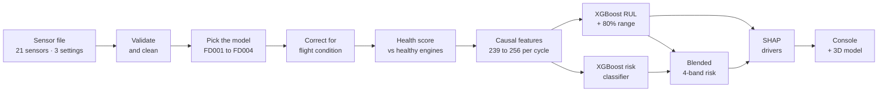

<p align="center">
  
</p>

<p align="center">
  
  
  
  
</p>

<h1 align="center">AeroSentinel</h1>

<p align="center">
  <b>Which engine needs attention next, how many cycles it has left, and which sensors are saying so.</b>
</p>

<p align="center">
  Predictive maintenance for turbofan engines: remaining-useful-life forecasts, four-band failure risk and
  sensor-level explanations, trained on all four NASA C-MAPSS subsets and delivered through an engineering console
  with a gas-path schematic and a 3D engine model.
</p>

<p align="center">
  <a href="#quick-start">Quick start</a> ·
  <a href="#inside-the-console">Inside the console</a> ·
  <a href="#how-it-works">How it works</a> ·
  <a href="#results">Results</a> ·
  <a href="#limitations-and-responsible-use">Limitations</a>
</p>

<table align="center">
  <tr>
    <td align="center"><h2>709</h2>training engines<br/><sub>FD001 to FD004 · one model each</sub></td>
    <td align="center"><h2>90 to 93%</h2>risk bands correct<br/><sub>NASA test sets · 707 engines</sub></td>
    <td align="center"><h2>9.6 to 10.7</h2>cycles of RUL error<br/><sub>RMSE · true RUL capped at 125</sub></td>
    <td align="center"><h2>6</h2>flight conditions corrected<br/><sub>altitude · Mach · throttle</sub></td>
    <td align="center"><h2>3.7 s</h2>to score 248 engines<br/><sub>FD004 · SHAP included</sub></td>
  </tr>
</table>

---

## Why it exists

A turbofan rarely fails without warning. As its compressor or fan wears, temperatures creep up, spool speeds shift
and fuel flow drifts: a little every cycle, spread across 21 sensor channels. In service the same engine also climbs,
cruises and throttles back, and those changes move the readings far more than wear does. Fixed maintenance schedules
ignore all of this. They pull healthy engines off the wing early and can still miss the one that is degrading fast.

AeroSentinel reads the full recorded history of every engine in a fleet, takes the flight condition out of each
reading, and answers four questions for each engine:

| Question | What you get |
|---|---|
| **How long has it got?** | Remaining useful life (RUL) in cycles, an 80% range around it, and the end-of-life window that range implies |
| **How worried should I be?** | One of four risk bands, *Normal*, *At risk*, *High risk* or *Failure likely*, with the model's probability |
| **What is changing, and where?** | A health score against healthy engines, and the drift of every sensor, module by module along the gas path |
| **Why does the model think so?** | The sensors that pushed this prediction up or down, ranked by SHAP |

---

## Inside the console


**Engine status** puts everything about one engine on a single screen: its condition, RUL on a banded scale, the
end-of-life window in cycles and how confident the model is. Below that, a **gas-path schematic** runs from fan
inlet to nozzle with the engineering stations (2, 24, 30, 50) marked. Each module is shaded by its most-drifted
sensor, and the flight condition of the latest cycle sits in the corner. Step through the fleet with *Previous* and
*Next*; the readouts animate from one engine's values to the next, so you see exactly what changed.


**3D model** places all 21 sensors at their real stations on a sectioned turbofan. *Replay* plays back the engine's
recorded life while the top bar tracks altitude, Mach and throttle for every cycle, and an event log notes each
escalation. Keys: `Space` replay or pause, `E` exploded view, `H` hide panels, `Esc` reset the camera.

**Ingest data** detects how many operating conditions a file contains, picks the matching model (or lets you
choose), times every pipeline stage and plots an **operating envelope**: where the engines flew, against the
conditions the model was trained on.

### Five condition states

Every engine is in exactly one state, always shown as a word and never by colour alone.

| State | Meaning |
|---|---|
| **Critical** | Predicted band is *Failure likely*: 15 cycles or fewer left |
| **Warning** | Predicted band is *High risk*: 16 to 30 cycles left |
| **Degrading** | Predicted band is *At risk* (31 to 60 cycles), or the health score is already abnormal |
| **Healthy** | *Normal* band and normal health |
| **Insufficient data** | Fewer than 30 cycles recorded, so trends are not yet reliable. It never hides a Critical or Warning result. |

<details>
<summary><b>Every page in the console</b></summary>
<br/>

| Section | Page | What it is for |
|---|---|---|
| Fleet | **Fleet overview** | A spec strip (model, conditions, fault modes), engines ranked by urgency, RUL forecast with 80% ranges, attention queue, health-trend heatmap and fleet-wide drivers. Click any engine to open it. |
| Fleet | **Ingest data** | Upload a C-MAPSS-format file or pick one of the four NASA test fleets; automatic or manual model choice, timed processing report and operating envelope. |
| Engine | **Engine status** | The single-engine summary and gas-path schematic shown above. |
| Engine | **Degradation** | Health score over time, the full sensor-drift table, and any sensor plotted against its healthy baseline. |
| Engine | **RUL and risk** | RUL history across the risk bands, the 80% range, review flags and a filterable fleet table. |
| Engine | **Explanations** | SHAP drivers behind the RUL and the risk prediction. |
| Engine | **3D model** | The sectioned engine shown above, with a deep-dive chart for any sensor you click. |
| Model | **Evaluation** | All four subsets side by side, a generalisation matrix (every model on every test fleet), then baselines, per-band results and confusion matrices for one subset. |
| Model | **Error analysis** | Where each model is wrong on its NASA test fleet, and by how much. |
| Output | **Export** | Engine results and cycle history as CSV, and the full result (model, conditions, timings) as JSON. |

The look is deliberately calm: IBM Plex type, a dark neutral palette with one blue accent, status colours reserved
for status, hairline engineering drawings, and motion only when something actually changes. Time-series charts read
like an oscilloscope, with a cursor line across the plot. Three.js, GSAP and the fonts ship with the repo, so the
console works offline.
</details>

---

## Quick start

You need Python 3.10 or newer. Trained models for all four subsets ship in `models/v3`, so there is nothing to train
before you start.

```bash
git clone https://github.com/Ruc-hi21/AeroSentineL.git
cd AeroSentineL
pip install -r requirements.txt
python -m scripts.download_data              # NASA C-MAPSS FD001 to FD004 into data/raw/
python -m streamlit run app/streamlit_app.py
```

Open **http://localhost:8501**, pick a NASA sample fleet (FD001 to FD004) and press **Load**. To try your own data,
use *Ingest data* with any file in the C-MAPSS layout (unit, cycle, 3 settings, 21 sensors).

| Also useful | Command |
|---|---|
| Retrain every subset from scratch (about 35 minutes, rewrites `reports/`) | `python -m training.train` |
| Retrain one subset | `python -m training.train --subset FD004` |
| Refresh test metrics and the benchmark from the saved models | `python -m training.train --rescore` |
| Rank engines by risk in the terminal (model picked automatically, or name one) | `python -m scripts.predict data/raw/test_FD002.txt` |
| Run the 61 tests (data, conditions, models, pipeline and every console page) | `python -m pytest` |

---

## How it works



1. **Validate and clean.** Checks the 26-column C-MAPSS layout, drops rows that cannot be tied to an engine and
   cycle, and flags readings outside the range seen in training.
2. **Pick the model.** Each subset has its own model. A file named after a subset uses that one, as long as its
   operating conditions agree with the name. Otherwise a file with one operating condition goes to the FD003 model
   and a file with several goes to FD004, the two that held up best on other subsets' data.
3. **Correct for the flight condition.** FD002 and FD004 engines fly six conditions, from sea level to 42,000 ft at
   Mach 0.84, at full or part throttle. The model finds them from the settings and maps every reading to the value it
   would show at the sea-level, full-throttle reference. For single-condition data this step leaves readings unchanged,
   and readings from a condition the model never saw are flagged rather than trusted.
4. **Score health.** The sensors that move (14 or 15 of the 21) are compared with a healthy baseline from the first
   30 cycles of the training engines. An engine is *abnormal* above the 99th percentile of healthy behaviour and
   *critical* at twice that.
5. **Engineer features.** All causal, so a cycle only ever sees its own past: rolling means and spreads over 5, 15,
   30 and 60 cycles, exponentially weighted means, 15/30/50/90-cycle trend slopes, and drift from the engine's own
   first 15 cycles.
6. **Predict RUL.** An XGBoost regressor learns RUL capped at 125 cycles (early life counts as fully healthy), and
   10th and 90th percentile quantile models give the 80% range.
7. **Classify risk.** The classifier's band probabilities are blended with the bands implied by the RUL forecast. The
   blend weight is chosen per subset by 5-fold cross-validation on training engines only.
8. **Explain.** SHAP ranks the five sensors with the most influence on each RUL and risk prediction.

| Risk band | Predicted RUL |
|---|---|
| **Failure likely** | 15 cycles or fewer |
| **High risk** | 16 to 30 cycles |
| **At risk** | 31 to 60 cycles |
| **Normal** | more than 60 cycles |

---

## Results

Every modelling choice was made with GroupKFold cross-validation on training engines, so no engine appears on both
sides of a split. Each NASA test set was scored once, at the end, at the last recorded cycle of every engine.

| Subset | Conditions | Fault modes | Train / test engines | Risk accuracy, test | Macro-F1, test | RUL RMSE, test | RMSE, capped truth | R², test | Accuracy, held-out engines |
|---|---|---|---|---|---|---|---|---|---|
| **FD001** | 1 | HPC | 100 / 100 | **92.0%** | 0.880 | 11.9 | 10.7 | 0.918 | 94.7% |
| **FD002** | 6 | HPC | 260 / 259 | **93.1%** | 0.854 | 22.4 | 9.7 | 0.826 | 94.2% |
| **FD003** | 1 | HPC and fan | 100 / 100 | **92.0%** | 0.885 | 11.2 | 9.6 | 0.927 | 95.0% |
| **FD004** | 6 | HPC and fan | 249 / 248 | **90.3%** | 0.818 | 23.5 | 10.4 | 0.815 | 94.2% |

**Two ways to read RMSE.** The model is trained to top out at 125 cycles, because early life looks the same to every
sensor. Many FD002 and FD004 test engines have more than 125 cycles left (57 and 67 of them), so the uncapped RMSE is
inflated by engines the model correctly calls "healthy, 125+". Capping the true RUL at 125 too is how most
published C-MAPSS results are scored; on that basis every subset lands between 9.6 and 10.7 cycles. The 80% range
holds the capped truth for 85 to 92% of test engines.

**When it is wrong, it is wrong by a little.** Across all 707 test engines, all 58 risk-band misses land in the
neighbouring band and 48 of them are within 5 cycles of a band limit. No engine that is truly *High risk* or
*Failure likely* is ever called *Normal*. With one prediction per test engine, test accuracy carries a standard
error of about ±3 points on FD001 and FD003 and about ±2 on FD002 and FD004.

**Generalisation.** Every model was also scored on every other subset's test fleet (risk accuracy):

| Model ↓ / test fleet → | FD001 | FD002 | FD003 | FD004 |
|---|---|---|---|---|
| FD001 model | **92%** | untrained conditions | 77% | untrained conditions |
| FD002 model | 92% | **93%** | 76% | 84% |
| FD003 model | 94% | untrained conditions | **92%** | untrained conditions |
| FD004 model | 91% | 93% | 93% | **90%** |

Models that saw both fault modes (FD003, FD004) keep their accuracy on single-fault data; single-condition models
cannot score multi-condition data at all, which the console flags instead of hiding. This table is why files
without a subset in their name go to FD003 or FD004.

<details>
<summary><b>FD001 across model versions, and against simpler models</b></summary>
<br/>

| FD001 | v1 | v2 | **v3** |
|---|---|---|---|
| Risk accuracy · 5-fold CV over training engines | 0.889 | 0.943 | **0.942** |
| Risk accuracy · 20 held-out engines, every cycle | 0.883 | 0.941 | **0.947** |
| Risk macro-F1 · held-out engines | 0.798 | 0.880 | **0.889** |
| Risk accuracy · official test set | 0.870 | 0.890 | **0.920** |
| Risk macro-F1 · official test set | | 0.832 | **0.880** |
| RUL RMSE · held-out engines (cycles) | 15.07 | 8.62 | **8.06** |
| RUL RMSE · official test set (cycles) | 17.09 | 12.31 | **11.90** |
| RUL R² · official test set | 0.831 | 0.912 | **0.918** |

v3 adds 60-cycle rolling windows and 90-cycle trends, chosen by 3-fold CV on training engines: CV RUL RMSE fell from
9.05 to 8.81 cycles on FD001 and from 10.20 to 9.33 on FD002.

On each subset's held-out engines, compared with simpler models trained on the same features:

| Held-out engines | FD001 | FD002 | FD003 | FD004 |
|---|---|---|---|---|
| RUL RMSE · linear regression | 15.2 | 13.6 | 13.1 | 14.1 |
| RUL RMSE · random forest | 9.8 | 10.4 | 9.2 | 10.7 |
| **RUL RMSE · AeroSentinel** | **8.1** | **8.9** | **7.8** | **9.5** |
| Risk accuracy · logistic regression | 93.1% | 92.1% | 94.4% | 92.1% |
| Risk accuracy · random forest | 92.0% | 92.6% | 93.6% | 93.1% |
| Risk accuracy · XGBoost classifier alone | 94.2% | 94.1% | 95.3% | 94.2% |
| **Risk accuracy · AeroSentinel** | **94.7%** | **94.2%** | **95.0%** | **94.2%** |
</details>

| Target | Goal | Achieved |
|---|---|---|
| RUL RMSE on test engines | below 18 cycles | **11.2 to 11.9** on single-condition subsets; **9.7 to 10.4** capped on multi-condition |
| Risk macro-F1 across the four bands | above 0.85 | **0.88 to 0.89** on FD001 and FD003, **0.85** on FD002; **0.82** on FD004, short |
| Scoring latency | under 25 ms per engine cycle | **about 0.1 ms per cycle**: 41,214 FD004 cycles in 3.7 s, SHAP included, on a laptop |

---

## Two interfaces

| Branch | Interface |
|---|---|
| `main` | The engineering console shown above: calm, dense, four subset models. |
| `ui-streamlit` | The earlier cinematic "mission control" interface, with neon styling and a glowing 3D engine, running the previous FD001-only model (v2). |

Switch with `git checkout ui-streamlit`, then start Streamlit as usual.

---

## Under the hood

<details>
<summary><b>Dataset</b></summary>
<br/>

NASA C-MAPSS turbofan engine degradation simulation, from the
[NASA Prognostics Data Repository](https://data.nasa.gov/dataset/C-MAPSS-Aircraft-Engine-Simulator-Data/xaut-bemq).
Training engines run until failure; test engines stop before failure, with their true RUL provided. Every cycle
carries 21 sensor channels and 3 operational settings (altitude, Mach number, throttle resolver angle).

| Subset | Train engines | Test engines | Operating conditions | Fault modes |
|---|---|---|---|---|
| FD001 | 100 | 100 | 1 (sea level) | HPC degradation |
| FD002 | 260 | 259 | 6 | HPC degradation |
| FD003 | 100 | 100 | 1 (sea level) | HPC and fan degradation |
| FD004 | 249 | 248 | 6 | HPC and fan degradation |
</details>

<details>
<summary><b>Repository layout</b></summary>
<br/>

```text
app/                    Streamlit console
  views/                one file per page
  engine3d/             Three.js engine model (custom component)
  instruments/          GSAP engine status panel and gas-path schematic (custom component)
  insights.py           condition states, confidence, sensor drift, suggested actions
  theme.py              design tokens and shared UI pieces
src/                    the pipeline: data, preprocessing, analysis, features, models, explainability, evaluation
  preprocessing/conditions.py   operating-condition detection and correction
  data/profile.py               picks the subset model for a file
training/train.py       trains and evaluates one model per subset, writes reports/ and the benchmark
scripts/                download_data.py, predict.py
models/v3/<subset>/     trained models and metadata per subset (v1 and v2, FD001 only, kept for comparison)
reports/<subset>/       metrics, test-set predictions, training figures; reports/benchmark.json compares all four
tests/                  pytest suite
```

`index.html`, `package.json` and `vite.config.js` at the root are an early web prototype and are not used by the
Streamlit console.
</details>

<details>
<summary><b>Tech stack</b></summary>
<br/>

| Layer | Tools |
|---|---|
| Data and ML | Python 3.10+, pandas, NumPy, scikit-learn (incl. KMeans for flight conditions), XGBoost, SHAP |
| Console | Streamlit, Plotly, Three.js r186, GSAP 3.15, IBM Plex Sans and Mono |
</details>

---

## Limitations and responsible use

- The data is **simulated** (C-MAPSS), not telemetry from real aircraft. Four subsets cover one or six operating
  conditions and one or two fault modes, still far narrower than a real fleet.
- Readings from **flight conditions outside training** are flagged, not corrected; such predictions are unreliable.
- A file's subset is taken from its name or its number of conditions. FD001 and FD003 data look alike, so unnamed
  single-condition files go to the FD003 model.
- RUL is capped at **125 cycles**: the model cannot tell an engine with 150 cycles left from one with 300.
- The risk-band limits are a **design choice**, not a validated regulatory standard.
- Suggested actions in the console are rules built on the model's outputs and are labelled as guidance.

> [!CAUTION]
> AeroSentinel is a **decision-support tool**. It is **not** a certified airworthiness determination, must **not**
> be used for real-time in-flight safety decisions, and does **not** replace certified maintenance procedures.
> Predictions inform human review; they never trigger maintenance action on their own.

---

## Team

Built by **Group 88** as an OJT capstone project:

- **Aarohi Ruchita**
- **Prem Singh**

The project is not accepting external contributions at the moment.

## License

Released under the [MIT License](LICENSE). Three.js (MIT), GSAP (standard no-charge license) and IBM Plex
(SIL Open Font License) are bundled under their own licences.
